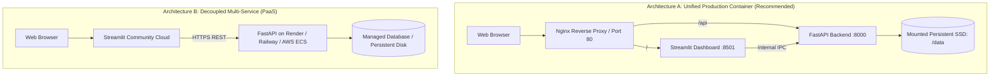

# 10. Cloud Deployment Configuration & Containerization Audit
**Project:** Agentic Predictive Maintenance Framework  
**Document ID:** AUDIT-10-CLOUD-CONFIG  
**Auditor:** Senior DevOps & Cloud Infrastructure Architect  
**Audit Date:** November 2026  
**Status:** ACTION REQUIRED — DOCKERFILE & DOCKER-COMPOSE REQUIRED  

---

## 1. Hosting Architecture Options

Because the platform comprises an asynchronous REST backend (FastAPI) and an interactive reactive frontend (Streamlit), two primary cloud deployment topologies exist:



### Evaluation of Options:
- **Topology A (Unified Docker Container)**: Ideal for single-instance VM hosting (AWS EC2, DigitalOcean Droplet, GCP Compute Engine, Azure VM, or self-hosted Docker). Simplest to manage, zero CORS issues, low latency internal communication.
- **Topology B (Decoupled PaaS)**: Frontend deployed on Streamlit Community Cloud (free) communicating with FastAPI backend on Render or Railway. Requires configuring `BACKEND_API_URL` and `CORS_ORIGINS`.

---

## 2. Dockerfile Specification (Remediation Deliverable)

To support instant one-click cloud containerization, a multi-stage, non-root, production-hardened `Dockerfile` is required:

```dockerfile
# Multi-stage production Dockerfile
FROM python:3.12-slim AS base

ENV PYTHONDONTWRITEBYTECODE=1 \
    PYTHONUNBUFFERED=1 \
    PORT=8000

WORKDIR /app

# Install system dependencies
RUN apt-get update && apt-get install -y --no-install-recommends \
    build-essential \
    curl \
    && rm -rf /var/lib/apt/lists/*

# Install Python dependencies
COPY requirements.txt .
RUN pip install --no-cache-dir --upgrade pip && \
    pip install --no-cache-dir -r requirements.txt

# Copy application assets
COPY app/ app/
COPY src/ src/
COPY config/ config/
COPY models/ models/
COPY data/processed/nasa/FD001/sequences_w30_val.npz data/processed/nasa/FD001/
COPY data/processed/nasa/FD001/val_tabular.csv data/processed/nasa/FD001/
COPY data/processed/ai4i/ data/processed/ai4i/
COPY run_dashboard.py .

# Create non-root user
RUN useradd -m -u 1000 appuser && \
    chown -R appuser:appuser /app
USER appuser

EXPOSE 8000 8501

HEALTHCHECK --interval=30s --timeout=5s --start-period=10s --retries=3 \
    CMD curl -f http://localhost:8000/health || exit 1

CMD ["python", "run_dashboard.py"]
```
