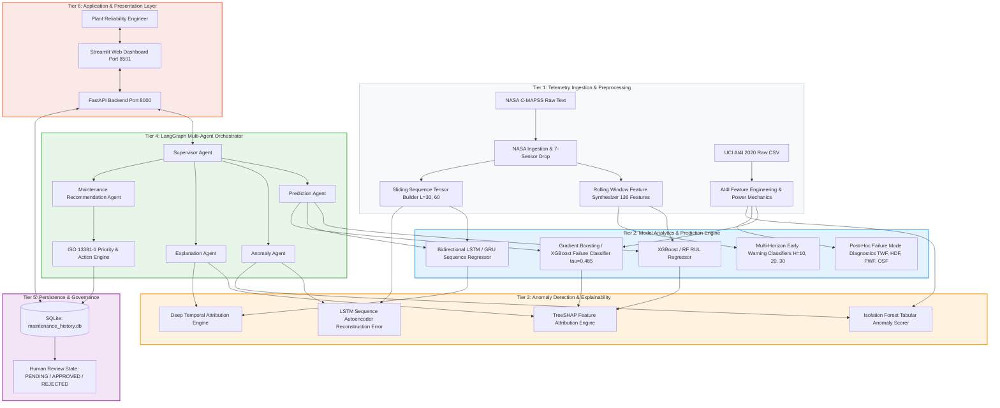
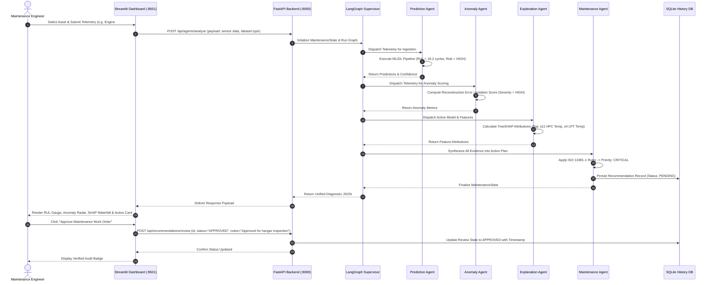

# Overall System Architecture & Workflow
## Agentic Predictive Maintenance Framework

---

## 1. High-Level Multi-Tier Industrial CPS Architecture

The framework is architected according to a 7-tier Cyber-Physical System (CPS) pattern. This modular separation guarantees that low-level sensor ingest, mathematical feature transformations, machine learning inference, agentic orchestration, and user interaction remain decoupled and independently maintainable.

---

## 2. End-to-End Diagnostic Sequence Workflow

When a predictive maintenance query is executed (via the dashboard or REST API), the system follows a deterministic execution sequence:

---

## 3. Resilience and Fallback Mechanisms
1. **Model Fallback Protocols**: If sequence data ($L=60$) is unavailable (e.g., in early engine cycles $t < 60$), the system automatically routes inference to the tabular XGBoost regressor, preventing sequence truncation crashes.
2. **Missing Feature Graceful Imputation**: Incomplete sensor dictionaries trigger forward-fill or median baseline replacement accompanied by an explicit data quality warning in the state output.
3. **Safety Disclaimers**: In compliance with industrial safety guidelines, all recommendations carry an explicit disclaimer stating that outputs represent non-autonomous decision support and mandate qualified personnel verification.
