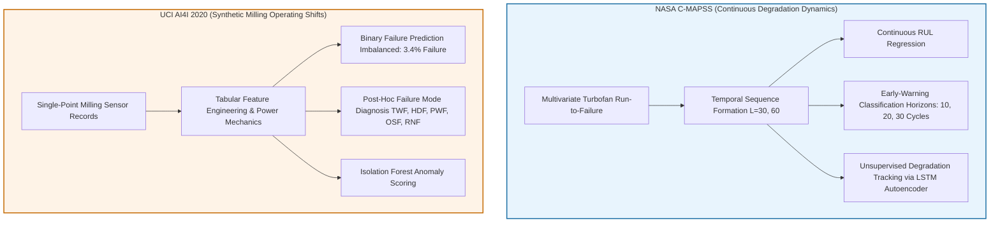

# Agentic Predictive Maintenance: An Explainable Multivariate Time-Series Framework for Early Machine Failure Detection and Maintenance Decision Support

## 1. Executive Summary & Abstract
The advent of Industry 4.0 and Cyber-Physical Systems (CPS) has precipitated massive influxes of multivariate sensor telemetry from industrial assets. However, legacy maintenance regimes remain bifurcated between reactive firefighting and costly, schedule-based overhauls. Traditional predictive maintenance (PdM) machine learning prototypes frequently stall at the "proof-of-concept" boundary due to three fundamental deficiencies:
1. **Opaque Black-Box Models**: Complex deep sequence estimators yield accurate scalar Remaining Useful Life (RUL) estimates but fail to provide human-interpretable causal attribution required for high-consequence operational decisions.
2. **Uncalibrated Sensor Drift vs. Acute Failure**: Classical classifiers struggle to differentiate benign sensor anomalies and operational regime shifts from catastrophic mechanical degradation.
3. **Absence of Autonomous Decision Orchestration**: Isolated predictive models output raw numerical probabilities without contextualizing machine operating history, component failure modes, maintenance urgency, or generating verifiable, human-in-the-loop action plans.

This project introduces an end-to-end, enterprise-grade **Agentic Predictive Maintenance Framework**. The architecture synergizes multivariate time-series deep learning (Bidirectional LSTM, GRU), gradient-boosted ensembles (XGBoost, Random Forest), unsupervised anomaly detectors (LSTM Autoencoders, Isolation Forests), and model-agnostic Explainable AI (TreeSHAP and Deep Temporal Attributions). Crucially, these analytic engines are coordinated under a **LangGraph-driven Multi-Agent Orchestration Layer** featuring dedicated Supervisor, Prediction, Anomaly, Explanation, and Maintenance Recommendation agents. The system culminates in an industrial FastAPI backend and a Streamlit interactive dashboard, providing real-time telemetry streaming, interactive SHAP attribution waterfalls, automated ISO 13381-1 priority assignment, and auditable SQLite human-in-the-loop maintenance authorization workflows.

---

## 2. Research Background & Problem Statement

### 2.1 The Industrial Maintenance Dilemma
Heavy industrial assets—including commercial turbofan engines, high-speed CNC milling centers, gas turbines, and wind power drivetrains—operate under severe thermodynamic and mechanical stress. Unplanned downtime in critical aerospace or manufacturing operations incurs staggering economic penalties, reaching up to $260,000 per hour in high-volume automotive manufacturing and substantial safety risks in aviation. 

Historically, asset operators relied on:
- **Run-to-Failure (Corrective Maintenance)**: Maximizes component service life but introduces severe catastrophic failure risks and collateral damage.
- **Time-Based Preventive Maintenance**: Imposes fixed overhaul schedules (e.g., replace turbine blades every 500 operating hours) based on worst-case statistical wear, causing premature retirement of functional equipment and exorbitant spare parts overhead.

### 2.2 Shortcomings of Conventional AI/ML Approaches
While Condition-Based Monitoring (CBM) and data-driven Predictive Maintenance (PdM) have been researched extensively, existing implementations exhibit critical real-world failure points:
- **Disconnection from Domain Actionability**: Model metrics such as Mean Squared Error (MSE) or Area Under ROC Curve (AUC) do not map directly to maintenance work orders. Plant engineers require answerability to three core questions: *When will the asset fail?*, *Which specific subsystem is degrading?*, and *What concrete corrective maintenance task must be performed today?*
- **Siloed Execution Pipelines**: In typical academic prototypes, anomaly detection, failure classification, and RUL regression are treated as disconnected studies rather than an integrated diagnostic funnel.
- **Lack of Governance and Advisory Verification**: Fully autonomous maintenance dispatch carries unacceptable risks of false shutdowns or improper repairs. Industrial environments mandate advisory systems equipped with strict human-in-the-loop approval workflows, complete telemetry audit trails, and explicit safety disclaimers.

---

## 3. Dataset Architectural Roles: NASA C-MAPSS vs. UCI AI4I 2020

A foundational architectural requirement of this framework is the strict separation and specialized application of two canonical benchmarks. These datasets represent fundamentally distinct physical regimes and predictive paradigms:

### 3.1 NASA C-MAPSS (Commercial Modular Aero-Propulsion System Simulation)
- **Physical Domain**: Simulated high-bypass turbofan engines undergoing continuous thermo-mechanical wear (high-pressure compressor fouling, turbine blade creep).
- **Temporal Nature**: Genuine run-to-failure multivariate time series where each engine trajectory starts in a healthy nominal state and deteriorates continuously over hundreds of flight cycles until operational failure threshold.
- **Task Scope in Framework**:
  1. Continuous Remaining Useful Life (RUL) regression with piecewise-linear target clipping ($RUL_{max} = 125$ cycles).
  2. Multi-horizon early-warning binary classification ($H \in \{10, 20, 30\}$ cycles).
  3. Unsupervised sequence anomaly tracking using LSTM Autoencoder reconstruction errors across healthy early-life baselines.
- **Data Integrity Rule**: Constant uninformative sensor channels (`sensor_1, 5, 6, 10, 16, 18, 19`) exhibiting zero variance are strictly eliminated prior to modeling.

### 3.2 UCI AI4I 2020 Predictive Maintenance Dataset
- **Physical Domain**: Synthetic operating condition records reflecting milling machine tool wear, thermodynamic dissipation, and rotational power mechanics.
- **Temporal Nature**: Single-record tabular snapshots (independent operating shifts). Crucially, the dataset does *not* provide continuous longitudinal engine trajectories.
- **Task Scope in Framework**:
  1. Imbalanced binary classification of overall machine failure (3.4% failure prevalence across 10,000 instances).
  2. Post-hoc failure-mode attribution across 5 specific mechanical failure causes: Tool Wear Failure (TWF), Heat Dissipation Failure (HDF), Power Failure (PWF), Overstrain Failure (OSF), and Random Failure (RNF).
  3. Feature mechanics modeling incorporating physically derived attributes (Rotational Power, Temperature Differential).
- **Target Leakage Prohibition**: The five individual failure mode flags are strictly sequestered from model training features and used exclusively for post-prediction diagnostic correlation.

---

## 4. Key Contributions of the Framework

1. **Dual-Paradigm Predictive Modeling**:
   - Engineered competitive traditional baselines (Linear Regression, Random Forest, Gradient Boosting, XGBoost) and advanced deep temporal architectures (LSTM, Bidirectional LSTM, GRU).
   - Validated that Bi-LSTM ($L=60$) achieves a superior NASA Scoring metric of **889.4** (90.7% reduction in asymmetric late-prediction penalty compared to baseline XGBoost).
2. **Transparent Multi-Level Explainability**:
   - Integrated TreeSHAP for tree ensembles to generate exact Shapley feature attributions, explaining sensor contributions for single-cycle anomalies and machine breakdown predictions.
   - Formulated deep temporal attribution gradients across sliding sequence windows, revealing temporal lag sensitivity and degradation acceleration profiles.
3. **First-of-its-Kind LangGraph Multi-Agent Industrial Orchestrator**:
   - Developed a deterministic state-graph architecture coordinating five specialized agents: `Supervisor`, `PredictionAgent`, `AnomalyAgent`, `ExplanationAgent`, and `MaintenanceAgent`.
   - Enabled intelligent conditional routing that dynamically invokes appropriate deep/ML model pipelines based on asset type, evaluates multi-model consensus, and flags conflicting predictive signals.
4. **Prescriptive Maintenance Recommendation Engine**:
   - Codified domain-grounded industrial rules aligned with **ISO 13381-1 condition monitoring standards**.
   - Translates raw RUL numbers and anomaly severity into categorized work orders (`CRITICAL`, `HIGH`, `MEDIUM`, `LOW`, `INFORMATIONAL`) accompanied by root-cause sensor attributions and required human sign-off levels.
5. **Full-Stack Enterprise Integration**:
   - Engineered a high-throughput, OpenAPI-compliant FastAPI backend paired with an industrial-grade Streamlit web control center.
   - Built a SQLite audit ledger (`maintenance_history.db`) enabling maintenance supervisors to inspect historical runs, record formal review decisions (`APPROVED`, `REJECTED`, `FURTHER_ANALYSIS_REQUESTED`), and export timestamped compliance logs.
6. **Strict Experimental Rigor & Zero Data Leakage**:
   - All preprocessing transformers (StandardScalers, MinMaxScalers, encoders) fitted exclusively on training splits.
   - Separate test sets ($N=100$ NASA test trajectories; $N=2,000$ AI4I held-out shifts) evaluated without target leakage or synthetic oversampling leakage.
