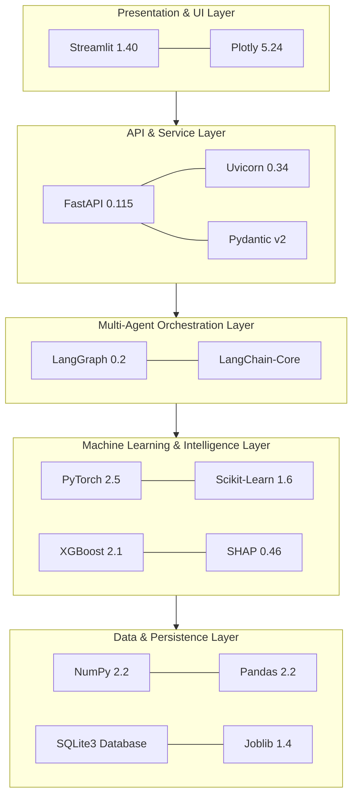

# Technology Stack Specification
## Agentic Predictive Maintenance Framework

The framework is constructed upon an enterprise-grade, open-source Python ecosystem designed for deterministic reproducibility, high computational throughput, and modular maintainability.

---

## 1. Technology Inventory & Architectural Role

| Layer / Domain | Technology / Library | Version | License | Architectural Role & Justification |
| :--- | :--- | :--- | :--- | :--- |
| **Language Runtime** | Python | `3.12.3` | PSF | Foundation runtime providing native asynchronous execution, robust typing, and broad scientific library support. |
| **Deep Learning** | PyTorch | `2.5.1` | BSD-3 | Primary framework for sequence degradation modeling (LSTM, Bidirectional LSTM, GRU) and temporal autoencoders. |
| **Traditional ML** | Scikit-Learn | `1.6.0` | BSD-3 | Baseline regression, classification algorithms, preprocessing transformers (StandardScaler, MinMaxScaler), and Isolation Forest. |
| **Gradient Boosting** | XGBoost | `2.1.3` | Apache-2.0 | Optimized gradient tree boosting for tabular failure prediction and tabular RUL regression with high training throughput. |
| **Explainable AI** | SHAP | `0.46.1` | MIT | TreeSHAP and KernelExplainer implementations delivering game-theoretic Shapley feature attributions. |
| **Agent Orchestration** | LangGraph | `0.2.64` | MIT | Cyclical and conditional state-graph orchestration coordinating multi-agent decision support workflows. |
| **Agent Primitives** | LangChain-Core | `0.3.31` | MIT | Base schema abstractions, state messaging protocols, and tool invocation contracts. |
| **REST Backend** | FastAPI | `0.115.6` | MIT | Asynchronous ASGI RESTful microservice providing OpenAPI docs, dependency injection, and endpoint validation. |
| **ASGI Server** | Uvicorn | `0.34.0` | BSD-3 | High-performance asynchronous web server for hosting FastAPI endpoints. |
| **Data Validation** | Pydantic | `2.10.5` | MIT | Strict JSON payload schema definition, type coercion, and runtime validation across all API endpoints. |
| **Interactive UI** | Streamlit | `1.40.2` | Apache-2.0 | Reactive frontend interface enabling rapid industrial prototyping, sensor streaming, and interactive telemetry exploration. |
| **Visualization** | Plotly | `5.24.1` | MIT | High-performance interactive JavaScript charting for degradation curves, radar plots, and confusion matrices. |
| **Data Manipulation** | Pandas | `2.2.3` | BSD-3 | Tabular data wrangling, rolling statistical window aggregation, and time-series indexing. |
| **Scientific Arrays** | NumPy | `2.2.1` | BSD-3 | Core N-dimensional array manipulations, sequence tensor packaging, and vector mathematical operations. |
| **Model Serialization**| Joblib | `1.4.2` | BSD-3 | High-throughput persistence for Scikit-learn transformers, tree models, and precalculated feature sets. |
| **Persistence Store** | SQLite3 | Native | Public Domain | Zero-configuration relational database engine for maintenance action history and human approval tracking. |
| **Documentation** | Python-Docx | `1.2.0` | MIT | Programmatic generation of formal Microsoft Word (.docx) technical reports and academic documentation. |
| **Testing Suite** | Unittest & Pytest | Native / `8.3` | MIT / PSF | Comprehensive regression harness executing 40 unit, integration, and end-to-end resilience test cases. |

---

## 2. Dependency Matrix & Interoperability
- **NumPy 2.x Compatibility**: All deep learning tensors and Scikit-learn array conversions were validated against NumPy 2.2 ABI standards to prevent legacy C-extension runtime faults.
- **Asynchronous Decoupling**: FastAPI operates as an independent backend service on port 8000, allowing headless integration with third-party SCADA or MES systems, while Streamlit interacts exclusively through standard HTTP/JSON requests.
- **Zero-External-Network Requirement**: The core multi-agent graph uses deterministic rule-augmented and heuristic intelligence nodes that execute entirely locally without requiring remote OpenAI/Anthropic cloud API keys. When external LLMs are disabled or offline, the system seamlessly uses local domain logic without service interruption.
