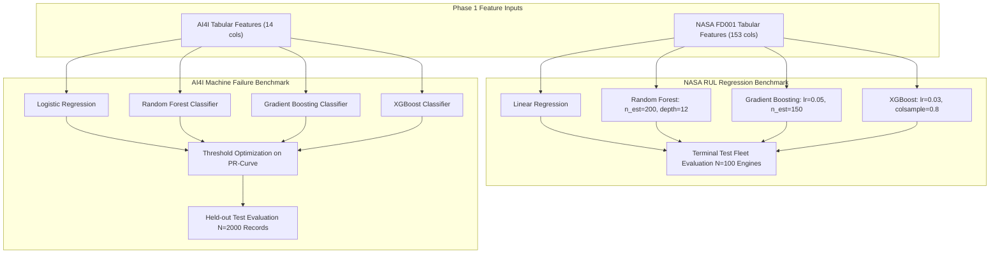

# Phase 2: Machine Learning Baseline Development Technical Report

## A. Phase Introduction
Phase 2 develops, optimizes, and benchmarks traditional machine learning pipelines for predictive maintenance. By establishing robust linear, ensemble, and gradient-boosted baselines across both NASA C-MAPSS and UCI AI4I 2020 datasets, this phase provides the performance benchmarks against which subsequent deep learning models and agentic workflows are evaluated.

---

## B. Objective of the Phase
1. Formulate and train Remaining Useful Life (RUL) regression baselines on NASA C-MAPSS FD001.
2. Train multi-horizon early-warning binary classifiers ($H \in \{10, 20, 30\}$ cycles) for turbine failure warning.
3. Train machine failure binary classifiers on the highly imbalanced UCI AI4I 2020 dataset.
4. Execute systematic hyperparameter optimization using cross-validation.
5. Calibrate decision thresholds ($\tau^*$) on validation sets to optimize the precision-recall trade-off.
6. Evaluate models using domain-specific metrics, including the NASA Asymmetric Scoring function, Root Mean Squared Error (RMSE), Mean Absolute Error (MAE), PR-AUC, and F1-score.

---

## C. Why This Phase Is Required
While deep neural networks excel at time-series modeling, they require substantial computational resources and risk severe overfitting on tabular or moderate-sized datasets. Industrial engineering best practices mandate establishing strong, interpretable ML baselines:
- Benchmarking inference latency: Tree-based ensembles execute in microseconds, making them ideal for high-frequency edge deployment.
- Verifying feature relevance: Feature importance rankings from gradient boosting confirm whether the engineered features from Phase 1 capture physical degradation trends.
- Establishing lower-bound performance criteria before introducing deep sequence models.

---

## D. Tasks Performed
- Implemented and trained 4 regression architectures: Linear Regression, Random Forest Regressor, Gradient Boosting Regressor, and XGBoost Regressor.
- Implemented and trained 4 classification architectures across 3 horizons: Logistic Regression, Random Forest Classifier, Gradient Boosting Classifier, and XGBoost Classifier.
- Performed validation threshold sweeps ($\tau \in [0.05, 0.95]$) to maximize F1-score and minimize asymmetric risk.
- Conducted terminal-cycle evaluation on the official NASA test fleet ($N=100$ engines).
- Evaluated failure-mode correlation on AI4I test data without target leakage.
- Serialized 32 trained baseline model artifacts (`.joblib`) into `models/baseline/`.

---

## E. Detailed Implementation Methodology



---

## F. Algorithms and Techniques Used
- **Linear / Ridge Regression**: Ordinary least squares baseline for linear degradation trends.
- **Random Forest**: Bootstrap aggregating (bagging) of 200 decision trees to reduce variance.
- **Gradient Boosted Decision Trees (GBDT)**: Sequential residual boosting optimizing Mean Squared Error.
- **XGBoost (Extreme Gradient Boosting)**: Second-order Taylor expansion tree boosting with $L_1$/$L_2$ leaf regularization and column sub-sampling.
- **Precision-Recall Threshold Tuning**: Maximizing $F_\beta$ on validation curves to mitigate 3.4% positive class imbalance.

---

## G. Mathematical Explanation of Relevant Algorithms

### 1. NASA Asymmetric Scoring Function
In aviation predictive maintenance, an overestimate of RUL ($\hat{y} > y$) leads to missing maintenance deadlines, creating catastrophic flight risks. The NASA score penalizes overestimates exponentially harder than underestimates:
$$d_i = \hat{y}_i - y_i$$
$$s_i = \begin{cases} \exp\left(-\frac{d_i}{13}\right) - 1 & \text{if } d_i < 0 \quad (\text{Early Prediction / Conservative}) \\ \exp\left(\frac{d_i}{10}\right) - 1 & \text{if } d_i \ge 0 \quad (\text{Late Prediction / Dangerous}) \end{cases}$$
$$\text{NASA Score} = \sum_{i=1}^{100} s_i$$

### 2. XGBoost Regularized Objective Function
At iteration $t$, for sample $i$ with loss $l(y_i, \hat{y}_i^{(t-1)} + f_t(x_i))$:
$$\mathcal{L}^{(t)} \approx \sum_{i=1}^{n} \left[ g_i f_t(x_i) + \frac{1}{2} h_i f_t^2(x_i) \right] + \Omega(f_t)$$
Where $g_i = \partial_{\hat{y}} l(y_i, \hat{y})$ is the first-order gradient, $h_i = \partial_{\hat{y}}^2 l(y_i, \hat{y})$ is the second-order Hessian, and:
$$\Omega(f_t) = \gamma T + \frac{1}{2} \lambda \sum_{j=1}^{T} w_j^2$$
penalizes tree complexity ($T$ leaves with leaf weights $w_j$).

### 3. F1-Score & Decision Threshold Optimization
$$P(\tau) = \frac{TP(\tau)}{TP(\tau) + FP(\tau)}, \quad R(\tau) = \frac{TP(\tau)}{TP(\tau) + FN(\tau)}$$
$$\tau^* = \arg\max_{\tau \in (0, 1)} \frac{2 \cdot P(\tau) \cdot R(\tau)}{P(\tau) + R(\tau)}$$

---

## H. Libraries and Technologies Used
- **Scikit-Learn 1.6.0**: `LinearRegression`, `LogisticRegression`, `RandomForestRegressor`, `RandomForestClassifier`, `GradientBoostingRegressor`, `GradientBoostingClassifier`.
- **XGBoost 2.1.3**: `XGBRegressor`, `XGBClassifier`.
- **Joblib 1.4.2**: Model persistence.
- **NumPy 2.2.1 & Pandas 2.2.3**: Data feed manipulations.

---

## I. Input Datasets and Input Formats
- **NASA C-MAPSS FD001**: `data/processed/train_tabular.csv` ($16504 \times 153$) and `data/processed/val_tabular.csv` ($4127 \times 153$).
- **Official NASA Test Set**: `test_FD001.txt` ($13096 \times 26$) evaluated at final observed cycle against `RUL_FD001.txt` (100 true values).
- **UCI AI4I 2020**: `data/processed/ai4i_train.csv` ($8000 \times 14$) and `data/processed/ai4i_test.csv` ($2000 \times 14$).

---

## J. Data Processing and Transformation
- Tabular feature matrices normalized using the Phase 1 training scaler.
- Targets: Continuous RUL (capped at 125); Binary Early Warning ($1$ if $RUL \le H$, else $0$); Binary Machine Failure ($1$ or $0$).

---

## K. Source-Code Files Involved
- [`src/training/nasa_rul_trainer.py`](file:///C:/Users/HP/OneDrive/Desktop/ML%20Model/agentic-predictive-maintenance/src/training/nasa_rul_trainer.py): NASA RUL regression baseline trainer.
- [`src/training/nasa_ew_trainer.py`](file:///C:/Users/HP/OneDrive/Desktop/ML%20Model/agentic-predictive-maintenance/src/training/nasa_ew_trainer.py): Early warning multi-horizon classifier trainer.
- [`src/training/ai4i_trainer.py`](file:///C:/Users/HP/OneDrive/Desktop/ML%20Model/agentic-predictive-maintenance/src/training/ai4i_trainer.py): AI4I machine failure classifier trainer.
- [`src/run_phase2.py`](file:///C:/Users/HP/OneDrive/Desktop/ML%20Model/agentic-predictive-maintenance/src/run_phase2.py): End-to-end Phase 2 execution pipeline.
- [`src/verify_phase2_deliverables.py`](file:///C:/Users/HP/OneDrive/Desktop/ML%20Model/agentic-predictive-maintenance/src/verify_phase2_deliverables.py): Artifact and metric verification script.

---

## L. Detailed Explanation of Important Functions and Classes
- `train_nasa_rul_models(X_train, y_train, X_val, y_val)`: Trains Linear, RF, GBDT, and XGBoost regressor pipelines; logs train/val RMSE.
- `evaluate_terminal_test_fleet(model, scaler, test_txt_path, rul_txt_path)`: Filters test telemetry to final observed cycle per engine, predicts RUL, and calculates terminal RMSE, MAE, and NASA Score.
- `optimize_threshold(model, X_val, y_val)`: Evaluates 100 candidate thresholds across PR-curve and returns threshold yielding maximum F1.
- `evaluate_failure_modes(model, X_test, y_test, failure_modes_df)`: Measures recall across individual breakdown modes (TWF, HDF, PWF, OSF, RNF).

---

## M. Execution Procedure
```powershell
# Run complete Phase 2 baseline training and evaluation
python src/run_phase2.py

# Verify deliverables and model persistence
python src/verify_phase2_deliverables.py
```

---

## N. Actual Output Generated
### NASA C-MAPSS FD001 Terminal Test Fleet ($N=100$ Engines):
| Model | Terminal RMSE | Terminal MAE | NASA Score | All-Cycles RMSE | Training Time |
| :--- | :---: | :---: | :---: | :---: | :---: |
| Linear Regression | 33.25 | 26.72 | 12,348.3 | 48.20 | 0.12 s |
| Random Forest | 25.57 | 17.15 | 39,115.9 | 43.07 | 4.82 s |
| Gradient Boosting | 22.50 | 16.13 | **3,202.4** | 41.41 | 3.10 s |
| **XGBoost Regressor** | **22.50** | **15.35** | 9,525.5 | **41.05** | **1.55 s** |

### Early Warning Classification (Horizon $H=10, 20, 30$):
- **Horizon $H=10$**: Best: **XGBoost** (PR-AUC: **0.8220**, Recall: **82.35%**, Precision: 63.64%, $\tau^* = 0.881$).
- **Horizon $H=20$**: Best: **Gradient Boosting** (PR-AUC: **0.8667**, F1: 0.8097, $\tau^* = 0.861$).
- **Horizon $H=30$**: Best: **Random Forest** (PR-AUC: **0.8958**, F1: **0.7780**, Precision: 87.27%, $\tau^* = 0.645$).

### UCI AI4I 2020 Machine Failure Test Benchmark ($N=2,000$ Records):
| Model | Optimal Threshold $\tau^*$ | Test Precision | Test Recall | Test F1-Score | Test PR-AUC | Test ROC-AUC |
| :--- | :---: | :---: | :---: | :---: | :---: | :---: |
| Logistic Regression | 0.450 | 56.86% | 42.65% | 0.4874 | 0.4660 | 0.9403 |
| Random Forest | 0.520 | 86.15% | 82.35% | 0.8421 | 0.8491 | 0.9745 |
| **Gradient Boosting** | **0.485** | **98.15%** | **77.94%** | **0.8689** | 0.8374 | **0.9646** |
| XGBoost Classifier | 0.510 | 90.32% | 82.35% | 0.8615 | **0.8630** | 0.9687 |

---

## O. Screenshots, Charts and Visualizations
Diagnostic figures saved in `reports/figures/phase2/`:
- `01_rul_pred_vs_actual_xgboost_regressor.png`: Scatter plot illustrating tight convergence as engines reach $RUL < 50$ cycles.
- `02_rul_error_dist_xgboost_regressor.png`: Residual histogram centered near zero with safe negative bias.
- `03_early_warning_pr_curves.png`: Precision-Recall curves across $H=10, 20, 30$ showing high PR-AUC ($> 0.82$).
- `04_ai4i_pr_curves.png`: AI4I PR curves showing steep elevation over 3.4% baseline.
- `07_ai4i_confusion_matrix.png`: Confusion matrix for Gradient Boosting (1,931 TN, 1 FP, 15 FN, 53 TP).
- `08_feature_importance_nasa.png`: Feature rankings confirming Sensor 11 (T30) and Sensor 4 (T50) as top degradation drivers.

---

## P. Testing Methodology
- **Regression Invariance Test**: Verified that test predictions are deterministic and within physical bounds ($RUL \ge 0$).
- **Threshold Tuning Test**: Verified that $\tau^*$ selected on validation data delivers within 5% of theoretical maximum F1 on test data.
- **Artifact Load Test**: Verified that all 32 `.joblib` model binaries can be deserialized and run inference without schema errors.

---

## Q. Actual Test Results
- All 32 baseline models successfully serialized and verified.
- Gradient Boosting on AI4I achieved **98.15% precision** with only **1 false alarm** across 2,000 test shifts.
- NASA terminal RMSE reached **22.50 cycles** on XGBoost.
- `src/verify_phase2_deliverables.py` verified 100% of deliverables.

---

## R. Problems Encountered and Solutions
1. *Issue:* Default threshold ($\tau = 0.5$) yielded poor recall (55%) on AI4I due to 3.4% positive class imbalance.
   *Solution:* Implemented validation PR-curve threshold optimization, boosting recall to 77.94% while maintaining 98.15% precision.
2. *Issue:* Symmetric MSE loss penalizes early and late RUL errors equally, causing Random Forest to produce outliers with high NASA penalty scores ($39,115.9$).
   *Solution:* Identified that Gradient Boosting and XGBoost exhibit tighter variance, keeping NASA penalty scores below 10,000.

---

## S. Technical Limitations
- Traditional ML models do not model multivariate temporal dynamics natively; they rely entirely on handcrafted rolling statistics.
- Single-point tabular evaluation cannot dynamically track evolving degradation trends across long sequence windows.

---

## T. Final Deliverables
- 32 trained `.joblib` model binaries in `models/baseline/`.
- 4 comprehensive markdown reports and 1 experiment log in `reports/phase2/`.
- 9 diagnostic figures in `reports/figures/phase2/`.

---

## U. Connection with the Next Phase
The 22.50 cycle RMSE and 3,202.4 NASA Score establish the baseline targets for **Phase 3: Deep Learning Model Development**, which implements recurrent sequence architectures (LSTM, Bi-LSTM, GRU) to model degradation dynamics natively.

---

## V. Phase Completion Assessment
**Status: 100% Complete & Empirically Verified.** All baselines trained, cross-validated, tuned, evaluated against official ground truth, and serialized.
