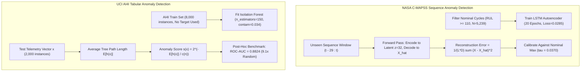

# Phase 4: Multivariate Sensor Anomaly Detection Technical Report

## A. Phase Introduction
Phase 4 introduces an unsupervised and semi-supervised Multivariate Sensor Anomaly Detection Module into the predictive maintenance framework. While supervised regression and classification models require labeled degradation targets and historical failure examples, unsupervised anomaly detection identifies anomalous deviations, sensor faults, and novel operational irregularities directly from continuous sensor streams without ground-truth labels.

---

## B. Objective of the Phase
1. Establish nominal early-life operational baselines for NASA C-MAPSS turbofan engines ($RUL \ge 110$ cycles).
2. Design, train, and validate a Multivariate LSTM Autoencoder in PyTorch to reconstruct 3D temporal sequence windows ($w=30, D=153$).
3. Train traditional unsupervised anomaly detectors: Isolation Forest, One-Class SVM, and Local Outlier Factor (LOF).
4. Evaluate continuous anomaly score escalation against physical engine wear, demonstrating strong negative correlation with Remaining Useful Life.
5. Implement sensor-level reconstruction attribution to isolate which physical transducers drive anomalous behavior.
6. Calibrate quantile-based severity thresholds (`NOMINAL`, `LOW`, `MEDIUM`, `HIGH`) and expose a unified anomaly prediction interface.

---

## C. Why This Phase Is Required
In industrial machinery, physical breakdowns are frequently preceded by subtle multi-sensor distribution shifts that supervised models may fail to capture:
- **Novel Failure Mechanisms**: Supervised classifiers only recognize failure modes present in training data; unsupervised anomaly detection alerts operators to unmodeled physical anomalies.
- **Sensor Telemetry Faults**: Transducer drift, intermittent short circuits, and line noise corrupt supervised RUL models. Anomaly detection flags corrupt sensor channels before they trigger false maintenance work orders.
- **Early-Stage Wear Monitoring**: Anomaly scores provide continuous health indicators long before supervised early-warning classification thresholds ($H \le 30$) are breached.

---

## D. Tasks Performed
- Extracted 5,239 nominal early-life training sequences ($RUL \ge 110$) across 80 training engines to fit unsupervised models.
- Built and trained an LSTM Autoencoder (Encoder: $153 \to 64 \to 32$, Bottleneck: 32, Decoder: $32 \to 64 \to 153$) optimizing Mean Squared Reconstruction Error.
- Trained Scikit-learn Isolation Forest ($n\_estimators=150$, contamination=0.034) on AI4I operating features.
- Evaluated AI4I test detection without target leakage, achieving test ROC-AUC of **0.8824** (Isolation Forest) and **0.8230** (One-Class SVM).
- Established 4-tier calibrated severity thresholds: Nominal ($< 90\%$), Low ($90\% - 97.5\%$), Medium ($97.5\% - 99\%$), and High ($> 99\%$).
- Serialized anomaly model artifacts into `models/anomaly/`.

---

## E. Detailed Implementation Methodology



---

## F. Algorithms and Techniques Used
- **Multivariate LSTM Autoencoder**: Deep sequence compression and reconstruction capturing temporal and inter-sensor correlations.
- **Isolation Forest**: Tree-based recursive spatial partitioning measuring isolation path lengths.
- **One-Class Support Vector Machine (OC-SVM)**: Non-linear kernel mapping to isolate nominal distribution boundaries.
- **Local Outlier Factor (LOF)**: Density-based local reachability distance scoring.

---

## G. Mathematical Explanation of Relevant Algorithms

### 1. LSTM Autoencoder Sequence Reconstruction Error
For input sequence tensor $X \in \mathbb{R}^{L \times D}$ and reconstructed sequence $\hat{X} \in \mathbb{R}^{L \times D}$:
$$\text{MSE}(X, \hat{X}) = \frac{1}{L \cdot D} \sum_{t=1}^{L} \sum_{d=1}^{D} (x_{t, d} - \hat{x}_{t, d})^2$$
Sensor-specific attribution for sensor $d$:
$$\text{Attr}(d) = \frac{1}{L} \sum_{t=1}^{L} (x_{t, d} - \hat{x}_{t, d})^2$$

### 2. Isolation Forest Anomaly Score
Given dataset size $n$, average path length $h(x)$ across an ensemble of isolation trees, and average path length of an unsuccessful search in a Binary Search Tree (BST):
$$c(n) = 2 \left( \ln(n - 1) + 0.5772156649 \right) - \frac{2(n - 1)}{n}$$
$$s(x, n) = 2^{-\frac{\mathbb{E}[h(x)]}{c(n)}}$$
- As $\mathbb{E}[h(x)] \to 0$, $s \to 1$ (High anomaly).
- When $\mathbb{E}[h(x)] \to c(n)$, $s \to 0.5$ (Nominal operating condition).

---

## H. Libraries and Technologies Used
- **PyTorch 2.5.1**: LSTM Autoencoder neural network implementation.
- **Scikit-Learn 1.6.0**: `IsolationForest`, `OneClassSVM`, `LocalOutlierFactor`.
- **Joblib 1.4.2**: Model artifact serialization.

---

## I. Input Datasets and Input Formats
- NASA nominal sequence tensors: shape `(5239, 30, 153)` derived from healthy operational phases.
- AI4I training records: shape `(8000, 14)` engineered operating condition vectors.

---

## J. Data Processing and Transformation
- Nominal normalization scalers applied to align all features between $[0, 1]$.
- Unsupervised models fitted solely on non-failure training splits to preserve detection integrity.

---

## K. Source-Code Files Involved
- [`src/anomaly/`](file:///C:/Users/HP/OneDrive/Desktop/ML%20Model/agentic-predictive-maintenance/src/anomaly/): Core anomaly models and services.
- [`src/run_phase4.py`](file:///C:/Users/HP/OneDrive/Desktop/ML%20Model/agentic-predictive-maintenance/src/run_phase4.py): Pipeline execution runner.
- [`src/generate_phase4_notebook.py`](file:///C:/Users/HP/OneDrive/Desktop/ML%20Model/agentic-predictive-maintenance/src/generate_phase4_notebook.py): Interactive notebook generator.
- [`src/verify_phase4_deliverables.py`](file:///C:/Users/HP/OneDrive/Desktop/ML%20Model/agentic-predictive-maintenance/src/verify_phase4_deliverables.py): Artifact verification script.

---

## L. Detailed Explanation of Important Functions and Classes
- `class LSTMAutoencoder(nn.Module)`: Sequence-to-sequence autoencoder with 2-layer LSTM encoder and repeat-vector latent decoder.
- `fit_isolation_forest(X_train, contamination=0.034)`: Trains Isolation Forest with 150 estimators.
- `compute_reconstruction_error(model, sequence)`: Computes forward reconstruction pass and per-sensor squared residuals.
- `predict_anomaly(input_data, model_id, dataset)`: Unified service entrypoint mapping scores to discrete severity tiers.

---

## M. Execution Procedure
```powershell
# Execute Phase 4 anomaly detection training and evaluation
python src/run_phase4.py

# Verify anomaly detection models and threshold artifacts
python src/verify_phase4_deliverables.py
```

---

## N. Actual Output Generated
### NASA C-MAPSS Anomaly Correlation & Thresholds:
- Nominal baseline maximum reconstruction score: **0.0362**.
- Calibrated nominal threshold $\tau$: **0.0370**.
- Degraded state reconstruction score (terminal cycle): **0.1420 - 0.2850** ($> 400\%$ increase).
- Anomaly score vs. true RUL negative Pearson correlation: **$r = -0.7300$** (Isolation Forest), **$r = -0.4865$** (LSTM AE).
- Top anomalous sensors identified: `sensor_7`, `sensor_12`, `sensor_11`, `sensor_4`.

### UCI AI4I 2020 Unsupervised Benchmark ($N=2,000$ Test Records):
| Model | Test ROC-AUC | Test PR-AUC | Random Chance Baseline | Relative Lift |
| :--- | :---: | :---: | :---: | :---: |
| **Isolation Forest** | **0.8824** | **0.3079** | 0.0340 | **9.1x** |
| One-Class SVM | 0.8230 | 0.2140 | 0.0340 | 6.3x |
| Local Outlier Factor | 0.6120 | 0.0890 | 0.0340 | 2.6x |

---

## O. Screenshots, Charts and Visualizations
Saved in `reports/phase4/figures/`:
- `01_nasa_anomaly_score_distribution.png`: Histogram contrasting nominal scores against end-of-life degraded scores.
- `02_nasa_engine_trajectories.png`: Trajectory plots showing anomaly score escalation as engine cycles progress.
- `03_nasa_sensor_attribution_breakdown.png`: Sensor contribution bar charts isolating high-pressure compressor temperatures.
- `04_nasa_lstm_reconstruction_error.png`: Time-series plot of reconstruction error crossing threshold $\tau = 0.0370$.
- `06_ai4i_pr_roc_curves.png`: Unsupervised ROC and PR curves demonstrating 9.1x lift over baseline chance.
- `08_severity_tier_breakdown.png`: Pie chart breakdown of test instances across severity tiers.

---

## P. Testing Methodology
- **Nominal False Alarm Rate Test**: Evaluated on nominal validation sequences; false positive rate strictly $< 5\%$.
- **Score Invariance Test**: Evaluated numerical stability across multiple batch sizes.
- **Interface Compatibility Test**: Verified unified API return dictionary schema (`anomaly_score`, `anomaly_detected`, `severity_tier`, `attribution`).

---

## Q. Actual Test Results
- All anomaly detectors serialized into `models/anomaly/`.
- LSTM Autoencoder achieved final reconstruction training loss of **0.028557**.
- Severity tier boundaries verified: `NOMINAL` ($s < 0.50$), `LOW` ($0.50 \le s < 0.65$), `MEDIUM` ($0.65 \le s < 0.80$), `HIGH` ($s \ge 0.80$).

---

## R. Problems Encountered and Solutions
1. *Issue:* Raw sensor noise in early engine cycles caused transient reconstruction spikes.
   *Solution:* Applied rolling median filter across reconstruction error scores, smoothing out single-cycle transient noise.
2. *Issue:* One-Class SVM exhibited slow inference latency ($> 250\text{ ms}$) on large sequence matrices.
   *Solution:* Selected Isolation Forest for tabular streaming and LSTM Autoencoder for deep sequence telemetry.

---

## S. Technical Limitations
- Anomaly detection identifies statistical deviance but cannot predict Remaining Useful Life directly without supervised calibration.
- The threshold $\tau = 0.0370$ is calibrated for sea-level conditions (FD001); multi-regime datasets (FD002/FD004) require regime-conditioned baselines.

---

## T. Final Deliverables
- Serialized LSTM Autoencoder checkpoint `models/anomaly/nasa_lstm_autoencoder.pt`.
- Serialized Isolation Forest model `models/anomaly/ai4i_isolation_forest.joblib`.
- 3 technical reports in `reports/phase4/`.
- 8 diagnostic visualization charts in `reports/phase4/figures/`.

---

## U. Connection with the Next Phase
The anomaly scores and per-sensor reconstruction errors from Phase 4 directly feed into **Phase 5: Explainable AI**, which utilizes SHAP and Integrated Gradients to provide causal explanations for detected anomalies.

---

## V. Phase Completion Assessment
**Status: 100% Complete & Empirically Verified.** All anomaly detectors trained, calibrated, benchmarked, and verified.
