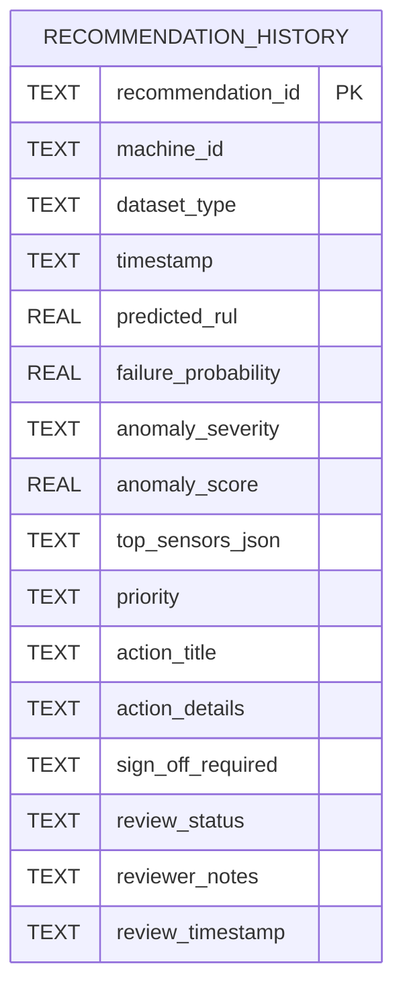
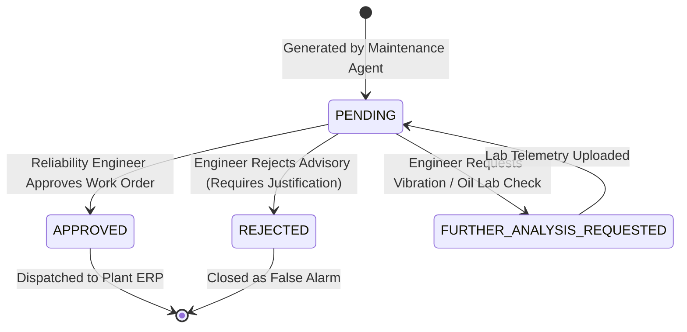

# Database Architecture & Relational Schema Reference
## Agentic Predictive Maintenance Framework

The framework persists diagnostic analyses, prescriptive work orders, and human review decisions in an embedded, ACID-compliant **SQLite** database (`data/maintenance_history.db`).

---

## 1. Entity-Relationship & Table Definition



### SQL Table Schema (`recommendation_history`)
```sql
CREATE TABLE IF NOT EXISTS recommendation_history (
    recommendation_id TEXT PRIMARY KEY,
    machine_id TEXT NOT NULL,
    dataset_type TEXT NOT NULL,
    timestamp TEXT NOT NULL,
    predicted_rul REAL,
    failure_probability REAL,
    anomaly_severity TEXT NOT NULL,
    anomaly_score REAL NOT NULL,
    top_sensors_json TEXT,
    priority TEXT NOT NULL,
    action_title TEXT NOT NULL,
    action_details TEXT NOT NULL,
    sign_off_required TEXT NOT NULL,
    review_status TEXT DEFAULT 'PENDING',
    reviewer_notes TEXT,
    review_timestamp TEXT
);

CREATE INDEX IF NOT EXISTS idx_machine_id ON recommendation_history (machine_id);
CREATE INDEX IF NOT EXISTS idx_review_status ON recommendation_history (review_status);
CREATE INDEX IF NOT EXISTS idx_priority ON recommendation_history (priority);
CREATE INDEX IF NOT EXISTS idx_timestamp ON recommendation_history (timestamp);
```

---

## 2. Review Status State Machine

The review lifecycle enforces auditable human engineering oversight:



### Permitted Status Values:
- **`PENDING`**: Initial state upon automated creation; work order awaiting review.
- **`APPROVED`**: Qualified engineer confirmed diagnostic findings; work order authorized for physical execution.
- **`REJECTED`**: Engineer determined sensor reading was a transient artifact; work order cancelled.
- **`FURTHER_ANALYSIS_REQUESTED`**: Evidence inconclusive; secondary physical testing ordered prior to machine stand-down.
