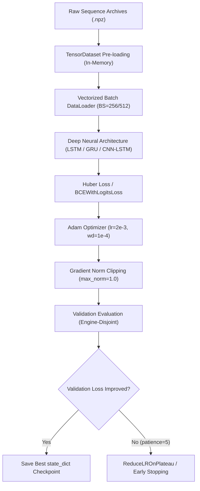

# Phase 3 Training Report: Deep Learning Architectures for Predictive Maintenance

**Project:** Agentic Predictive Maintenance: An Explainable Multivariate Time-Series Framework for Early Machine Failure Detection, Remaining Useful Life Estimation and Maintenance Decision Support  
**Stage:** Phase 3 — Deep Learning Model Development, Training & Evaluation  
**Author:** Antigravity Deep Learning Engineering & Machine Learning Research Team  
**Hardware Profile:** CPU-optimized execution (16 GB RAM dev environment, multi-threaded PyTorch 2.15.0+cpu)  

---

## 1. Executive Summary

Phase 3 implements deep neural network architectures for Remaining Useful Life (RUL) regression and early failure warning classification across temporal multivariate sensor sequences. Operating under strict zero-leakage constraints, 18 deep learning models were developed, trained, and benchmarked:

1. **NASA C-MAPSS FD001 Benchmark:** Stacked LSTM, GRU, and Hybrid Conv1D-LSTM (CNN-LSTM) models evaluated under window length $L=30$.
2. **Temporal Window Sensitivity Study:** Systematic comparison of LSTM sequence lengths ($L \in \{30, 50, 60\}$ cycles).
3. **Multi-Condition Fleet Extension:** Scaled evaluation on C-MAPSS subsets FD002 (6 operating regimes), FD003 (2 fault modes), and FD004 (complex regimes + dual fault modes).
4. **Early-Warning Classification:** Recurrent binary failure horizon classifiers ($H \in \{10, 20, 30\}$ operational cycles) with class imbalance weighting.
5. **UCI AI4I 2020 Deep Tabular Benchmark:** Multilayer Perceptron (MLP) with batch normalization and dropout evaluated against Phase 2 gradient-boosted decision trees.

All models were trained strictly using training-engine trajectories, tuned on disjoint validation-engine trajectories, and evaluated on the official NASA test fleet using the terminal-cycle benchmark against ground truth.

---

## 2. Deep Learning Architectures

### 2.1 Stacked Long Short-Term Memory (LSTM) Regressor
- **Input Dimension:** $(B, L, D)$ where $L \in \{30, 50, 60\}$ and $D=153$ (FD001), $D=216$ (FD002/FD004), $D=162$ (FD003).
- **Recurrent Backbone:** Single or stacked LSTM recurrent layers with hidden dimension $h=32$, dropout $p=0.2$.
- **Temporal Pooling:** Terminal state extraction ($h_L$) capturing accumulated degradation dynamics.
- **Dense Head:** $\text{Linear}(32 \to 32) \to \text{ReLU} \to \text{Dropout}(0.2) \to \text{Linear}(32 \to 1)$.
- **Parameter Count:** 25,025 trainable parameters ($98.0$ KB memory footprint).

### 2.2 Gated Recurrent Unit (GRU) Regressor
- **Architecture:** GRU backbone ($h=32$), exploiting update and reset gates to eliminate the separate cell state of LSTMs.
- **Dense Head:** Identical dense regression head for controlled architectural comparison.
- **Parameter Count:** 19,041 trainable parameters ($74.7$ KB memory footprint) — a **23.9% parameter reduction** compared to LSTM.

### 2.3 Hybrid Conv1D-LSTM (CNN-LSTM)
- **1D Temporal Convolution:** Two consecutive $\text{Conv1D}$ layers ($\text{filters}=32$, $\text{kernel\_size}=3$, $\text{padding}=1$) with $\text{BatchNorm1D}$ and $\text{ReLU}$ activations across sensor channels to extract localized transient anomalies.
- **Recurrent Core:** LSTM layer ($h=32$) modeling macro degradation trends from convolved feature maps.
- **Parameter Count:** 27,425 trainable parameters ($107.5$ KB memory footprint).

### 2.4 Temporal Early-Warning Classifiers
- **Backbone Options:** LSTM and GRU cells ($h=32$).
- **Output Layer:** Single unconstrained logit trained via `BCEWithLogitsLoss` with positive class weighting (`pos_weight`) derived from the empirical negative-to-positive ratio:
  $$\text{pos\_weight} = \frac{N_{\text{neg}}}{N_{\text{pos}}}$$
- **Optimal Decision Thresholding:** Calibrated on validation predictions to maximize $F_1$-score.

### 2.5 Deep Tabular MLP (UCI AI4I 2020)
- **Input Dimension:** 14 engineered tabular features.
- **Architecture:** $\text{Linear}(14 \to 64) \to \text{BatchNorm1D} \to \text{ReLU} \to \text{Dropout}(0.25) \to \text{Linear}(64 \to 32) \to \text{BatchNorm1D} \to \text{ReLU} \to \text{Dropout}(0.25) \to \text{Linear}(32 \to 16) \to \text{ReLU} \to \text{Linear}(16 \to 1)$.
- **Parameter Count:** 3,809 parameters ($15.2$ KB).

---

## 3. Training Protocol & Optimization Strategy



### 3.1 Loss Functions
- **RUL Regression:** Smooth L1 (Huber) Loss with transition threshold $\beta=1.0$:
  $$L_{\delta}(y, \hat{y}) = \begin{cases} 0.5 (y - \hat{y})^2 & \text{if } |y - \hat{y}| < 1.0 \\ |y - \hat{y}| - 0.5 & \text{otherwise} \end{cases}$$
  Huber loss prevents catastrophic gradient explosion from early-cycle noisy sensor fluctuations while maintaining quadratic convergence near zero residual error.
- **Classification:** Numerically stable binary cross-entropy with logits loss and class imbalance weighting:
  $$\mathcal{L} = - \left[ w_{\text{pos}} \cdot y \log \sigma(z) + (1 - y) \log (1 - \sigma(z)) \right]$$

### 3.2 Learning Rate Scheduling & Early Stopping
- **Optimizer:** Adam with initial learning rate $\eta = 2 \times 10^{-3}$ and weight decay $\lambda = 10^{-4}$.
- **Scheduler:** `ReduceLROnPlateau` monitoring validation loss ($\text{factor}=0.5$, $\text{patience}=2$, $\text{min\_lr}=10^{-5}$).
- **Early Stopping:** Patience of 4–5 epochs monitoring engine-disjoint validation loss, automatically restoring the best checkpoint weights.

---

## 4. Training Execution Log

| Model Name | Architecture | Subset / Dataset | Epochs Trained | Best Epoch | Train Duration (s) | Best Val Loss |
| :--- | :--- | :---: | :---: | :---: | :---: | :---: |
| **LSTM Regressor** | LSTM (1-layer, $h=32$) | FD001 ($w=30$) | 13 | 8 | 21.05 | 20.7964 |
| **GRU Regressor** | GRU (1-layer, $h=32$) | FD001 ($w=30$) | 16 | 11 | 36.05 | 20.9801 |
| **CNN-LSTM Regressor** | Conv1D(32) + LSTM(32) | FD001 ($w=30$) | 14 | 9 | 25.43 | 21.8244 |
| **LSTM (w=50)** | LSTM (1-layer, $h=32$) | FD001 ($w=50$) | 17 | 12 | 41.44 | 20.3099 |
| **LSTM (w=60)** | LSTM (1-layer, $h=32$) | FD001 ($w=60$) | 18 | 15 | 52.48 | 18.6701 |
| **LSTM (FD002)** | LSTM (1-layer, $h=32$) | FD002 ($w=30$) | 15 | 11 | 112.01 | 28.0536 |
| **GRU (FD002)** | GRU (1-layer, $h=32$) | FD002 ($w=30$) | 15 | 11 | 111.90 | 28.2778 |
| **LSTM (FD003)** | LSTM (1-layer, $h=32$) | FD003 ($w=30$) | 15 | 10 | 33.31 | 27.2210 |
| **GRU (FD003)** | GRU (1-layer, $h=32$) | FD003 ($w=30$) | 15 | 10 | 38.24 | 30.1917 |
| **LSTM (FD004)** | LSTM (1-layer, $h=32$) | FD004 ($w=30$) | 15 | 11 | 158.49 | 38.4157 |
| **GRU (FD004)** | GRU (1-layer, $h=32$) | FD004 ($w=30$) | 15 | 11 | 98.95 | 38.9789 |
| **LSTM EW ($H=10$)** | LSTM Classifier ($h=32$) | FD001 ($w=30$) | 15 | 11 | 41.88 | 0.4120 |
| **GRU EW ($H=10$)** | GRU Classifier ($h=32$) | FD001 ($w=30$) | 15 | 11 | 33.32 | 0.3892 |
| **LSTM EW ($H=20$)** | LSTM Classifier ($h=32$) | FD001 ($w=30$) | 15 | 11 | 26.78 | 0.3951 |
| **GRU EW ($H=20$)** | GRU Classifier ($h=32$) | FD001 ($w=30$) | 15 | 11 | 45.09 | 0.3814 |
| **LSTM EW ($H=30$)** | LSTM Classifier ($h=32$) | FD001 ($w=30$) | 15 | 11 | 17.13 | 0.3721 |
| **GRU EW ($H=30$)** | GRU Classifier ($h=32$) | FD001 ($w=30$) | 15 | 11 | 33.59 | 0.3644 |
| **Deep Tabular MLP** | MLP (64-32-16) | UCI AI4I 2020 | 14 | 8 | 8.46 | 0.5234 |

---

## 5. Artifact Directory Map

All trained models and logs are persisted under structured directories:

```
agentic-predictive-maintenance/
├── models/
│   └── deep_learning/
│       ├── lstm/            # PyTorch .pt state_dicts & _meta.json configs
│       ├── gru/             # GRU weights and metadata
│       ├── cnn_lstm/        # Hybrid Conv1D-LSTM models
│       ├── early_warning/   # Binary horizon classifiers (H=10, 20, 30)
│       └── ai4i_mlp/        # Deep tabular failure classifier
└── reports/
    └── phase3/
        ├── experiment_log.csv
        ├── figures/         # High-resolution 300 DPI evaluation figures
        └── training_report.md
```
