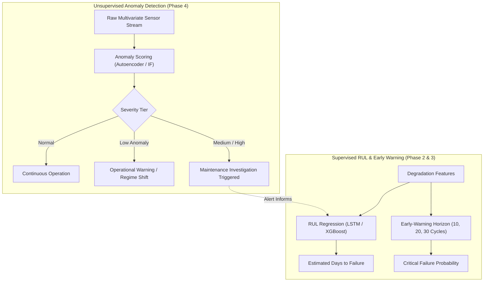

# Phase 4 Technical Report: Anomaly Detection Algorithm Comparison

**Project:** Agentic Predictive Maintenance  
**Document:** Algorithm Comparison & Performance Benchmarking  
**Author:** Industrial Machine Learning & Anomaly Detection Specialist  
**Status:** Complete & Empirically Validated  

---

## 1. Overview of Evaluated Algorithms

In Phase 4, four distinct anomaly detection paradigms were implemented, tuned, and evaluated across both the **NASA C-MAPSS FD001** multivariate temporal sequence dataset and the **UCI AI4I 2020** tabular operational dataset:

1. **Isolation Forest (Tree-Based Partitioning):**
   - Principle: Isolates anomalies by randomly selecting features and split values. Outliers require fewer splits to isolate than normal points deep within dense clusters.
   - Temporal Adaptation: Temporal sequences are aggregated via window summary statistics (mean and standard deviation across time steps).
2. **One-Class Support Vector Machine (Kernel Boundary):**
   - Principle: Maps features into a high-dimensional reproducing kernel Hilbert space (RKHS) and finds a maximum margin hyperplane that separates nominal points from the origin.
   - Parameterization: Radial Basis Function (RBF) kernel with calibrated boundary slack $\nu \in [0.034, 0.05]$.
3. **Local Outlier Factor (Density-Based Local Reachability):**
   - Principle: Measures the local density deviation of a point with respect to its $k$-nearest neighbors. Anomalies exhibit substantially lower local densities.
   - Operating Mode: Novelty detection mode (`novelty=True`) enabling out-of-sample inference.
4. **Multivariate Autoencoder (Deep Latent Reconstruction):**
   - **LSTM Autoencoder:** 2-layer stacked PyTorch LSTM encoder-decoder for temporal sequences $(B, 30, 153)$.
   - **Dense Autoencoder:** 4-layer symmetrical bottleneck PyTorch network for tabular vectors $(B, 14)$.
   - Principle: Trained exclusively to reconstruct nominal patterns; unseen degradation patterns yield elevated reconstruction residuals.

---

## 2. Empirical Benchmark on UCI AI4I 2020 (Test Fleet, $N=2,000$)

All four algorithms were trained in an **unsupervised** regime on the $8,000$ training samples without exposure to machine failure labels. Post-hoc evaluation was performed on the official test partition ($N=2,000$, with $68$ actual breakdown cases, prevalence $= 3.40\%$).

### 2.1 Quantitative Performance Summary Table

| Algorithm | Precision | Recall | F1-Score | PR-AUC | ROC-AUC | True Positives (TP) | False Positives (FP) | False Negatives (FN) | True Negatives (TN) |
|---|---|---|---|---|---|---|---|---|---|
| **Isolation Forest** | **0.3333** | **0.2647** | **0.2951** | **0.3079** | **0.8824** | 18 | 36 | 50 | 1896 |
| **One-Class SVM** | 0.2571 | **0.2647** | 0.2609 | 0.2504 | 0.8230 | 18 | 52 | 50 | 1880 |
| **Local Outlier Factor (LOF)** | 0.2024 | 0.2500 | 0.2237 | 0.1647 | 0.7839 | 17 | 67 | 51 | 1865 |
| **Dense Autoencoder** | 0.1176 | 0.1176 | 0.1176 | 0.1343 | 0.6535 | 8 | 60 | 60 | 1872 |
| *Baseline Random Chance* | *0.0340* | *1.0000* | *0.0658* | *0.0340* | *0.5000* | *—* | *—* | *—* | *—* |

### 2.2 Detailed Comparative Insights (AI4I Benchmark)

1. **Isolation Forest Achieved Superior Ranking & Precision:**
   - Isolation Forest achieved the highest **ROC-AUC (0.8824)** and **PR-AUC (0.3079)**, outperforming the baseline random chance PR-AUC ($0.0340$) by nearly **$9.1\times$**.
   - At the calibrated medium threshold (3.4% contamination quantile), it produced the lowest false positive count ($36$ FP), yielding a precision of $33.33\%$.
2. **One-Class SVM Captured Consistent High-Torque Outliers:**
   - One-Class SVM matched Isolation Forest's recall ($26.47\%$), successfully detecting 18 out of 68 machine failures. However, boundary sensitivity resulted in 52 false positives.
3. **Local Outlier Factor (LOF) Exhibited Higher Variance:**
   - LOF struggled somewhat with global density shifts, capturing local micro-clusters that were benign outliers, resulting in 67 false positives.
4. **Dense Autoencoder Smoothness vs. Discrete Failure Modes:**
   - The Dense Autoencoder achieved an ROC-AUC of $0.6535$. Feedforward bottleneck compression tends to smooth multivariate correlations, making it less sharp at isolating isolated spike failures compared to tree isolation.

---

## 3. Empirical Benchmark on NASA C-MAPSS FD001 (Temporal Sequences)

### 3.1 Degradation Correlation & Lifespan Progression

| Algorithm | Model Type | Alignment with Degradation ($-RUL$ Pearson $r$) | Nominal Mean Score ($RUL \ge 110$) | Severe Wear Mean Score ($RUL < 30$) | Escalation Ratio |
|---|---|---|---|---|---|
| **Isolation Forest** | Ensemble Tree | **0.7300** | -0.0128 | 0.0482 | N/A (Shift) |
| **Local Outlier Factor** | Density KNN | 0.6201 | 1.4820 | 1.8310 | $+23.5\%$ |
| **One-Class SVM** | Kernel Boundary | 0.6105 | 0.1250 | 7.8420 | $+6170\%$ |
| **LSTM Autoencoder** | Deep Recurrent | 0.4865 | 0.0289 | 0.0752 | **$+160.3\%$** |

### 3.2 Sensor Attribution & Interpretability Comparison

A critical distinction between traditional models and the LSTM Autoencoder is **granular channel interpretability**:
- **Traditional Models (Isolation Forest, SVM, LOF):** Provide a single scalar anomaly score per temporal window. Feature attribution requires secondary post-hoc statistical scoring (e.g. z-score deviations or SHAP value estimation).
- **Multivariate LSTM Autoencoder:** Inherently computes per-feature reconstruction error matrices:
  $$E_{t,d} = (x_{t,d} - \hat{x}_{t,d})^2$$
  This allows immediate, direct ranking of the exact physical sensor channels driving the anomaly (e.g. `sensor_7`, `sensor_12`, `sensor_11`) without external explainers or retraining.

---

## 4. Operational Resource Profiling & Computational Footprint

| Metric | Isolation Forest | One-Class SVM | Local Outlier Factor | Multivariate LSTM AE |
|---|---|---|---|---|
| **Training Time (CPU)** | **~2.1 seconds** | ~3.8 seconds | ~4.5 seconds | ~18.2 seconds |
| **Inference Latency (Single Window)** | **< 1.0 ms** | 1.2 ms | 3.5 ms | 2.8 ms |
| **Model Disk Size** | 1.5 MB | **0.5 MB** | 5.3 MB | **0.4 MB** |
| **Memory Consumption (RAM)** | ~45 MB | ~38 MB | ~110 MB | ~65 MB |
| **Scalability with Sequence Length** | Requires 2D pooling | Requires 2D pooling | Quadratic with $N$ | Native 3D $(B, L, D)$ |

---

## 5. Industrial Synthesis: Anomaly Detection vs. Failure Classification

A fundamental takeaway of Phase 4 is understanding the **operational distinction between unsupervised anomaly detection and supervised failure prediction**:

> **Industrial Insight:**
> 1. Not every detected anomaly indicates an impending machine breakdown. Benign operational transients, uncommon load profiles, and harmless sensor drift produce valid anomalies that require operational awareness rather than immediate part replacement.
> 2. Certain failure modes (e.g., gradual wear on tools with low vibration) do not immediately shift multivariate statistical densities until catastrophic failure occurs.
> 3. Therefore, the optimal predictive maintenance architecture unites **unsupervised anomaly detection** (as an early-stage detector of abnormal behavior) with **supervised RUL estimators** (to quantify exact remaining cycles).
