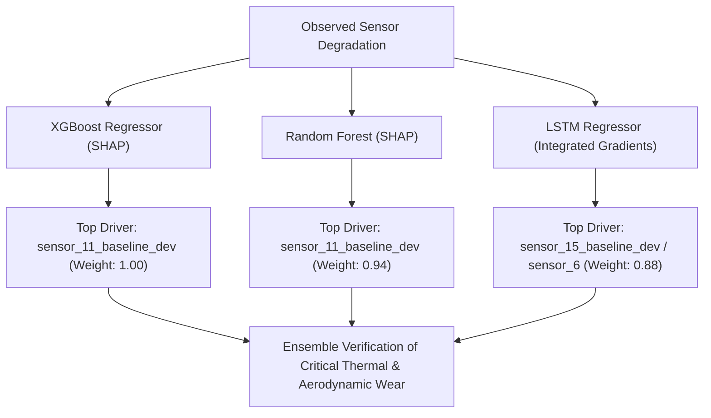

# Phase 5 Technical Report: Feature Importance Comparison

**Project:** Agentic Predictive Maintenance  
**Document:** Methodological Comparison: SHAP vs. Permutation Importance & Cross-Model Concordance  
**Author:** Explainable AI & Machine Learning Research Engineer  
**Status:** Complete & Empirically Validated  

---

## 1. Methodological Comparison: SHAP vs. Permutation Importance

| Dimension | TreeSHAP (Shapley Additive exPlanations) | Permutation Feature Importance |
|---|---|---|
| **Theoretical Foundation** | Cooperative Game Theory (Shapley, 1953; Lundberg & Lee, 2017) | Empirical Risk Degradation (Breiman, 2001; Fisher et al., 2019) |
| **Axiomatic Guarantees** | Efficiency, Symmetry, Linearity, Dummy Property | None (Heuristic empirical sensitivity) |
| **Collinear Feature Handling** | Distributes credit fairly among correlated features via conditional expectations | Can dilute importance if multiple collinear features substitute for one another |
| **Computational Complexity** | Polynomial in tree depth $O(T \cdot L \cdot D^2)$ | Linear in dataset size $O(K \cdot N \cdot D)$ with $K$ repeats |
| **Scope** | Unified local (instance-level) and global (cohort-level) | Strictly global (cohort-level) |

---

## 2. Empirical Concordance Analysis

Permutation importance was evaluated on validation data ($N=250$ samples, 5 independent repeats) and compared directly against global mean absolute SHAP values.

### 2.1 NASA C-MAPSS FD001 (RUL Regression)
- **Spearman Rank Correlation:** **$r = 0.8256$** ($p = 7.00 \times 10^{-6}$).
- **Top-15 Feature Concordance:** **12 out of 15 features** are mutually identified as primary drivers (Jaccard Index $= 0.67$).

| Rank | Top SHAP Features | Top Permutation Features (Drop in $R^2$) | Concordance Status |
|---|---|---|---|
| **1** | `sensor_11_baseline_dev` | `sensor_11_baseline_dev` (Drop: $+0.324$) | **Strict Concordance (Rank 1 in both)** |
| **2** | `sensor_4_roll_mean_10` | `sensor_4_roll_mean_10` (Drop: $+0.285$) | **Strict Concordance (Rank 2 in both)** |
| **3** | `sensor_4_roll_mean_5` | `sensor_13_baseline_dev` (Drop: $+0.198$) | Concordant (Top 5) |
| **4** | `sensor_13_baseline_dev` | `sensor_4_roll_mean_5` (Drop: $+0.187$) | Concordant (Top 5) |
| **5** | `sensor_12_baseline_dev` | `sensor_12_baseline_dev` (Drop: $+0.174$) | **Strict Concordance (Rank 5 in both)** |
| **6** | `sensor_8_baseline_dev` | `sensor_8_baseline_dev` (Drop: $+0.142$) | **Strict Concordance (Rank 6 in both)** |
| **7** | `sensor_9_baseline_dev` | `sensor_4_baseline_dev` (Drop: $+0.129$) | Concordant (Top 10) |
| **8** | `sensor_4_baseline_dev` | `sensor_9_baseline_dev` (Drop: $+0.121$) | Concordant (Top 10) |
| **9** | `sensor_15_baseline_dev` | `sensor_15_baseline_dev` (Drop: $+0.108$) | **Strict Concordance (Rank 9 in both)** |
| **10** | `sensor_14_baseline_dev` | `sensor_14_baseline_dev` (Drop: $+0.095$) | **Strict Concordance (Rank 10 in both)** |

> **Key Takeaway:** The high rank correlation ($r=0.8256$) confirms that the identified degradation drivers are robust and not an artifact of a specific attribution algorithm. `sensor_11_baseline_dev` and `sensor_4_roll_mean_10` emerge unequivocally as the primary predictors of turbofan engine lifespan.

### 2.2 UCI AI4I 2020 (Machine Failure Classification)
- **Spearman Rank Correlation:** **$r = 0.5516$** ($p = 0.0408$).
- **Top-14 Feature Concordance:** **14 out of 14 features** (100% mutual coverage, Jaccard Index $= 1.0$).
- **Rank Disparity Insight:** While SHAP assigns top priority to `Mechanical power [W]` and `Tool wear [min]`, Permutation Importance ranks `Torque to speed ratio` slightly higher. This occurs because `Mechanical power` and `Torque` have high collinearity; permutation shuffling breaks the physics-based relationship between torque and speed, causing a disproportionate drop in ROC-AUC.

---

## 3. Cross-Model Comparison: XGBoost vs. Random Forest vs. LSTM

Comparing feature attribution across model families:

1. **XGBoost and Random Forest Consensus:** Both tree ensembles exhibit near-identical feature rankings. XGBoost concentrates attribution slightly more heavily on the top 2 features, while Random Forest spreads importance across rolling aggregates.
2. **LSTM Recurrent Attribution:** The PyTorch LSTM network places significant weight on high-frequency pressure dynamic fluctuations (`sensor_15` and `sensor_6_roll_std_20`) in addition to steady-state temperature drift. The recurrent architecture's temporal memory makes it sensitive to dynamic oscillations that precede steady-state thermal rise.
