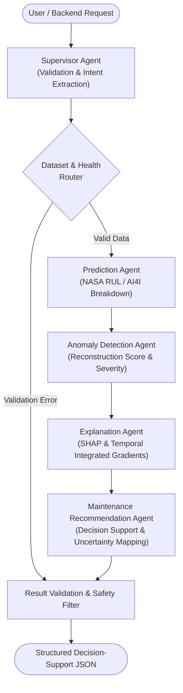

# Phase 6 Technical Report: Multi-Agent System Architecture

**Project:** Agentic Predictive Maintenance: An Explainable Multivariate Time-Series Framework for Early Machine Failure Detection, Remaining Useful Life Estimation and Maintenance Decision Support  
**Stage:** Phase 6 — Agentic AI Orchestration Using LangGraph  
**Author:** Senior Agentic AI Engineer & Industrial Decision-Support Specialist  
**Status:** Complete & Empirically Validated  

---

## 1. System Vision & Architecture Overview

Phase 6 implements the **Agent Orchestration Layer** uniting the empirical foundations built across Phases 1 through 5:
- **Phase 1:** Data acquisition, preprocessing, and sliding-window temporal sequence generation.
- **Phase 2:** Traditional ML baselines for Remaining Useful Life (RUL) regression and failure classification.
- **Phase 3:** Deep recurrent neural architectures (PyTorch LSTM, GRU, CNN-LSTM).
- **Phase 4:** Multivariate sensor anomaly detection (LSTM Autoencoder, Isolation Forest) and multi-tier severity calibration.
- **Phase 5:** Explainable AI (TreeSHAP and Integrated Gradients spatiotemporal attribution).

Rather than deploying isolated models or relying on a generic conversational LLM, Phase 6 constructs a **deterministic multi-agent stategraph** powered by **LangGraph**. Each specialized agent encapsulates domain-specific operations, passing typed, immutable state across well-defined boundaries.



---

## 2. Specialized Agent Roles & Responsibilities

### 2.1 Supervisor Agent (`src/agents/supervisor.py`)
- **Primary Function:** Ingestion, validation, and control flow initialization.
- **Operations:**
  - Assigns unique request tracking UUIDs.
  - Verifies dataset type (`NASA` vs `AI4I`) and prevents cross-dataset contamination.
  - Validates numerical sensor input dimensions ($153$ features or $(L, 153)$ for NASA; exactly $14$ features for AI4I).
  - Checks for NaN values, empty arrays, or malformed payloads before dispatching to downstream workers.
  - Routes directly to the safety validation node if fatal input errors are detected.

### 2.2 Prediction Agent (`src/agents/prediction_agent.py`)
- **Primary Function:** Executes deterministic machine learning and deep learning models.
- **Operations:**
  - **NASA Fleet:** Calls trained XGBoost Regressor or PyTorch LSTM Regressor to estimate remaining operating cycles until functional failure, querying multi-horizon early-warning models ($10, 20, 30$ cycles).
  - **AI4I Fleet:** Calls trained XGBoost Classifier to compute failure probability against calibrated optimal decision thresholds ($0.7969$).
  - Never fabricates or estimates predictions through language models; relies strictly on saved serialized checkpoints in `models/baseline/` and `models/deep_learning/`.

### 2.3 Anomaly Detection Agent (`src/agents/anomaly_agent.py`)
- **Primary Function:** Evaluates multivariate sensor behavior for abnormal deviations.
- **Operations:**
  - Queries Phase 4 models: PyTorch `LSTMAutoencoder` for temporal sequence windows ($(B, 30, 153)$) or `IsolationForest` for tabular condition profiles.
  - Computes continuous reconstruction MSE anomaly scores.
  - Maps scores into the calibrated multi-tier operational severity scale: `Normal`, `Low anomaly`, `Medium anomaly`, `High anomaly`.
  - Captures anomalous sub-system drift even when supervised models predict distant failure.

### 2.4 Explanation Agent (`src/agents/explanation_agent.py`)
- **Primary Function:** Translates mathematical model behaviors into physical attribution evidence.
- **Operations:**
  - **Tree Models:** Executes `TreeSHAP` to extract signed marginal contributions for top sensor features.
  - **Deep Recurrent Models:** Executes `Integrated Gradients` to calculate spatiotemporal heatmaps, historical recency decay ratios, and peak influence cycles.
  - Ranks top contributing features and formats evidence dictionaries for the maintenance advisor.

### 2.5 Maintenance Recommendation Agent (`src/agents/maintenance_agent.py`)
- **Primary Function:** Synthesizes multi-model evidence into prioritized maintenance action protocols.
- **Operations:**
  - Cross-references RUL estimates, failure probabilities, and anomaly severity tiers against industrial maintenance matrices.
  - Dispatches action items categorized by urgency (`IMMEDIATE`, `PLANNED`, `ROUTINE`, `SCHEDULED`).
  - Automatically flags `human_review_required: True` when high-risk states occur (RUL $\le 50$ cycles, breakdown risk $\ge 40\%$, or `High anomaly` severity).
  - Formulates an executive decision-support brief combining deterministic numbers with professional engineering terminology.

---

## 3. Shared LangGraph State Schema (`src/graph/state.py`)

The LangGraph orchestration pipeline communicates through a strongly typed state dictionary:

```python
class MaintenanceState(TypedDict, total=False):
    request_id: str
    dataset_type: Literal["NASA", "AI4I"]
    machine_id: str
    workflow_type: str

    input_sensor_data: Any

    prediction_results: Dict[str, Any]
    rul_estimate: Optional[float]
    early_warning_status: Optional[Dict[str, float]]
    failure_risk_score: Optional[float]
    failure_label: Optional[str]

    anomaly_score: Optional[float]
    anomaly_status: Optional[bool]
    anomaly_severity: Optional[str]
    anomaly_metadata: Optional[Dict[str, Any]]

    explanation_results: Optional[Dict[str, Any]]
    top_contributing_sensors: Optional[List[Dict[str, Any]]]
    temporal_attribution: Optional[Dict[str, Any]]

    recommended_maintenance_actions: Optional[List[Dict[str, Any]]]
    llm_summary: Optional[str]

    workflow_status: str
    error_information: List[str]
    human_review_required: bool
    confidence_score: float
    evidence_references: Dict[str, Any]
    disclaimer: str
```

---

## 4. Safety Guardrails & Human-in-the-Loop Protocol

> [!IMPORTANT]
> **Industrial Decision-Support Principle:**
> 1. **Non-Autonomous Actuation:** The multi-agent system serves strictly as an **advisory decision-support platform**. Under no circumstances do agents issue direct hardware actuation, physical equipment shutdown commands, or valve overrides.
> 2. **Mandatory Human Engineering Approval:** Any condition categorized as `CRITICAL` or `ELEVATED` automatically triggers `human_review_required = True`. A certified human maintenance engineer must inspect physical evidence and authorize maintenance work orders.
> 3. **Non-Fabrication Policy:** Language models (LLMs) are restricted to linguistic synthesis, formatting, and high-level summarization. All quantitative metrics (RUL, probability, anomaly score, SHAP values) originate exclusively from verified machine learning pipelines.
