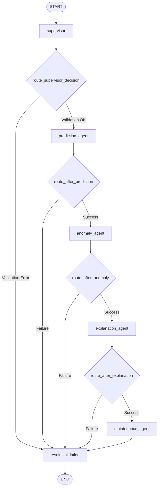

# Phase 6 Technical Report: LangGraph Workflow Documentation

**Project:** Agentic Predictive Maintenance  
**Document:** LangGraph Workflow Mechanics, Routing Protocols & Public API Reference  
**Author:** Senior Agentic AI Engineer & Industrial Decision-Support Specialist  
**Status:** Complete & Empirically Validated  

---

## 1. LangGraph StateGraph Architecture

The orchestration engine is compiled as a `StateGraph(MaintenanceState)` utilizing conditional edge branching for fault tolerance and dataset routing:



### 1.1 Node Execution Details
1. **`supervisor`:** Ingests raw payload, verifies dataset type (`NASA` or `AI4I`), checks tensor dimensions, and asserts non-NaN numerical values.
2. **`prediction_agent`:** Dispatches to `ModelService` to compute RUL (NASA) or failure probability (AI4I).
3. **`anomaly_agent`:** Dispatches to `ModelService` to compute reconstruction error and calibrated severity tier.
4. **`explanation_agent`:** Dispatches to `ExplanationService` to extract SHAP / Integrated Gradients sensor contributions.
5. **`maintenance_agent`:** Synthesizes evidence, applies industrial rules, determines urgency, and formulates the engineering brief.
6. **`result_validation`:** Verifies schema completeness, compiles evidence references, and enforces safety disclaimers.

---

## 2. Dataset-Aware Routing Logic

To strictly prevent data leakage and operational mismatch, separate execution pipelines are maintained:

### 2.1 NASA C-MAPSS Routing Profile
- **Input Requirements:** 153 features (tabular vector) or $(L, 153)$ temporal sliding window sequence ($L=30$).
- **Prediction Target:** Remaining Useful Life (cycles) and multi-horizon early-warning risks ($10, 20, 30$ cycles).
- **Anomaly Modeling:** PyTorch `LSTMAutoencoder` reconstruction score.
- **Explainability:** Temporal Integrated Gradients (time-step decay and 2D heatmap) + TreeSHAP.
- **Subsystems Evaluated:** HPC, LPT, bypass duct, fan rotational speeds, core bleed ratios.

### 2.2 UCI AI4I 2020 Routing Profile
- **Input Requirements:** Exactly 14 engineered operational condition features.
- **Prediction Target:** Machine breakdown probability and binary failure classification.
- **Anomaly Modeling:** Scikit-learn `IsolationForest` / Dense Autoencoder.
- **Explainability:** `TreeSHAP` marginal feature impacts.
- **Subsystems Evaluated:** Spindle power, rotational speed, torque, tool wear, heat dissipation index.

---

## 3. Reusable Public API Reference

The backend exposes five dedicated service interfaces in [`src/graph/workflow.py`](file:///c:/Users/HP/OneDrive/Desktop/ML%20Model/agentic-predictive-maintenance/src/graph/workflow.py):

### 3.1 `analyze_machine(input_data, dataset_type, machine_id=...)`
The primary comprehensive entry point executing the entire multi-agent pipeline.

#### Output Payload Schema (Prompt Requirement 8 Compliant):
```json
{
  "dataset": "NASA",
  "machine_id": "ENG-CRIT-99",
  "workflow_status": "COMPLETED",
  "rul_prediction": 5.92,
  "failure_risk_score": null,
  "failure_label": null,
  "anomaly_status": "ANOMALY_DETECTED",
  "anomaly_severity": "High anomaly",
  "anomaly_score": 0.082415,
  "important_sensor_contributions": [
    {
      "feature": "sensor_11_baseline_dev",
      "contribution": "negative",
      "importance": -14.25,
      "raw_value": 0.428
    },
    {
      "feature": "sensor_4_roll_mean_10",
      "contribution": "negative",
      "importance": -11.80,
      "raw_value": 0.512
    }
  ],
  "explanation_summary": "ENGINEERING DECISION SUPPORT BRIEF — ENG-CRIT-99 (NASA Turbofan Fleet)\n• Status: CRITICAL | Anomaly Severity: High anomaly | Estimated Remaining Life: 5.9 cycles\n• Primary Physical Degradation Driver: 'sensor_11_baseline_dev'\n• Recommended Protocol: Schedule urgent borescope inspection and thermal overhaul for sub-system 'sensor_11_baseline_dev'.\n• Action Urgency: IMMEDIATE (Within 2-5 Cycles)",
  "suggested_maintenance_actions": [
    {
      "action_id": "ACT-CRIT-01",
      "priority": "HIGH",
      "urgency": "IMMEDIATE (Within 2-5 Cycles)",
      "target_subsystem": "sensor_11_baseline_dev",
      "description": "Schedule urgent borescope inspection and thermal overhaul for sub-system 'sensor_11_baseline_dev'.",
      "justification": "Predicted RUL is critically low (5.9 cycles) with 'High anomaly' sensor anomaly."
    }
  ],
  "confidence_or_uncertainty_information": {
    "model_confidence_score": 0.92,
    "early_warning_horizons": {
      "risk_within_10_cycles": 0.9412,
      "risk_within_20_cycles": 0.9855,
      "risk_within_30_cycles": 0.9991
    }
  },
  "evidence_references": {
    "prediction_evidence": { "predicted_rul": 5.92, "units": "operational_cycles" },
    "anomaly_evidence": { "score": 0.082415, "severity": "High anomaly", "status": true },
    "attribution_evidence": ["sensor_11_baseline_dev", "sensor_4_roll_mean_10"]
  },
  "human_review_status": {
    "human_review_required": true,
    "disclaimer": "NOTICE: The generated recommendations are decision-support advisories based on predictive and statistical models. They do NOT constitute autonomous equipment commands. Consequential actions require physical verification and authorized human engineering approval."
  },
  "errors": []
}
```

### 3.2 `assess_failure_risk(input_data, machine_id="MACHINE-001")`
Convenience API tailored for CNC manufacturing and tabular operations. Returns failure probability, breakdown label, anomaly severity, and immediate action item.

### 3.3 `estimate_remaining_useful_life(input_data, machine_id="ENGINE-001")`
Convenience API tailored for turbofan engine prognosis. Returns predicted RUL cycles, early-warning probabilities, and urgency tier.

### 3.4 `explain_machine_condition(input_data, dataset_type, machine_id="UNIT-001")`
Convenience API focused strictly on evidence extraction. Returns top contributing sensor drivers, SHAP/IG impacts, and natural-language explanation.

### 3.5 `recommend_maintenance(input_data, dataset_type, machine_id="UNIT-001")`
Convenience API retrieving prescriptive maintenance action items, priority ratings, and authorized sign-off requirements.
