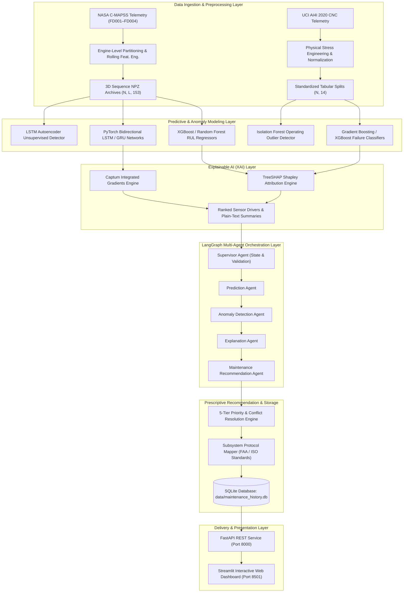
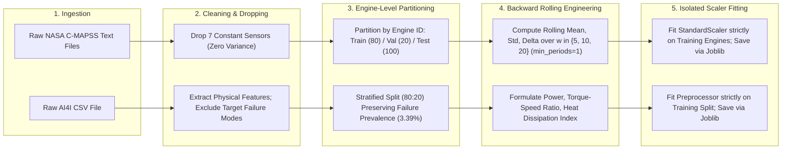
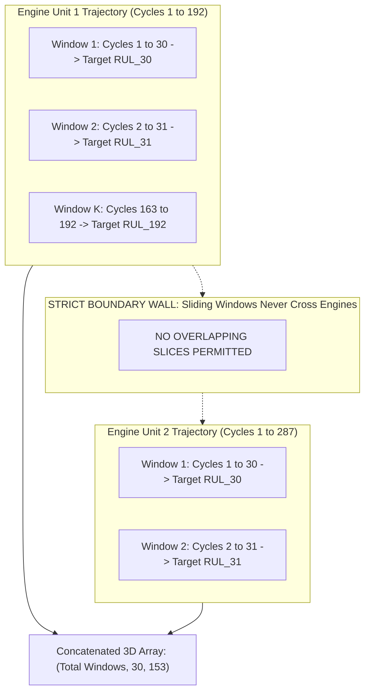
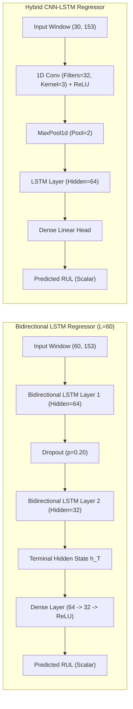
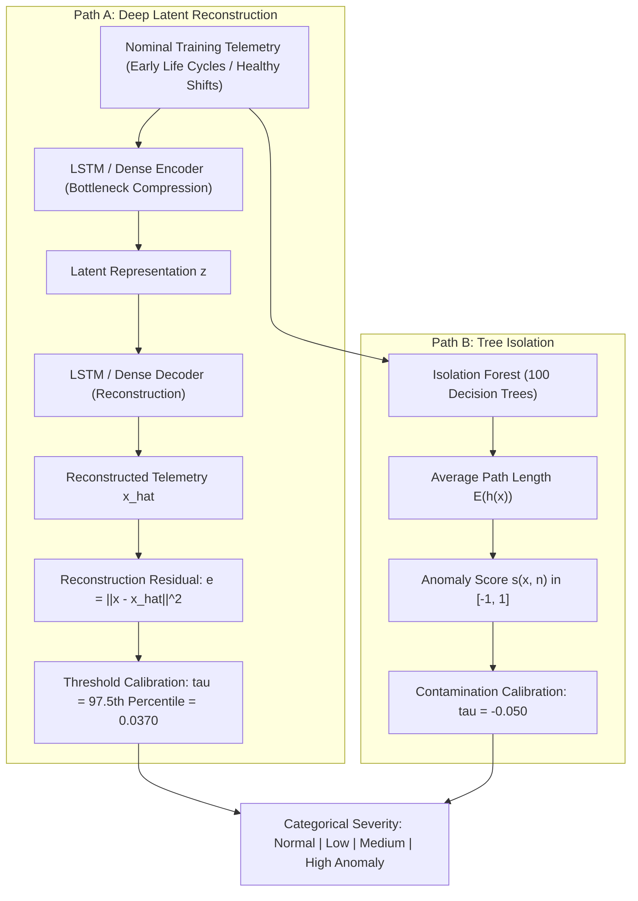
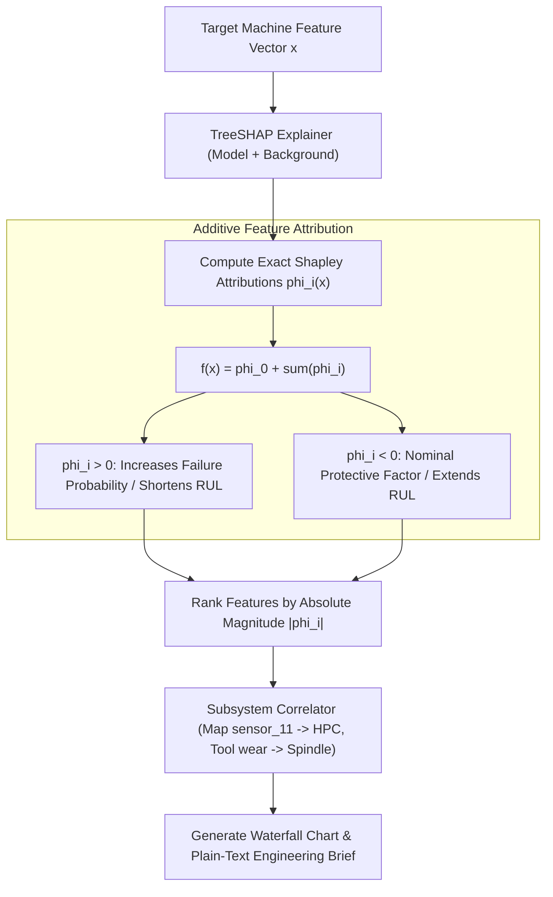
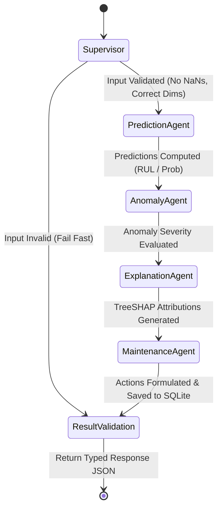
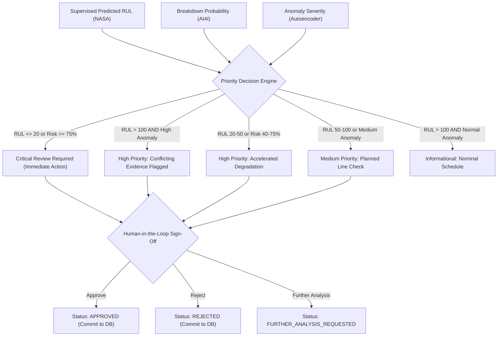
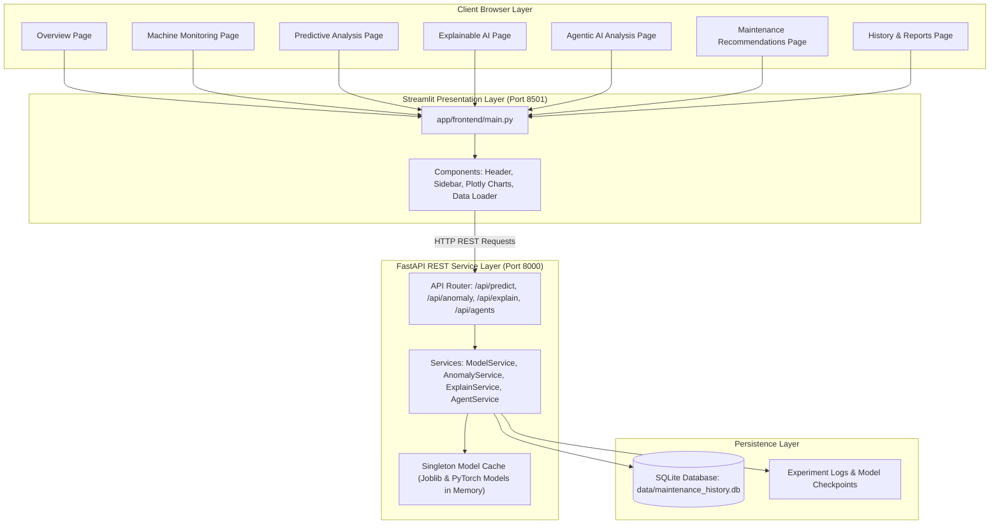

# Phase 9: Research Methodology & Architecture Diagrams
## Comprehensive Mermaid Visualizations for Project Thesis and Technical Presentations

---

### Diagram 1: Overall End-to-End System Architecture

---

### Diagram 2: Data Preprocessing & Leakage-Free Feature Engineering

---

### Diagram 3: NASA Temporal 3D Sequence Construction (No Engine Boundary Overlap)

---

### Diagram 4: Deep Learning Time-Series Model Architectures

---

### Diagram 5: Unsupervised Anomaly Detection Pipeline

---

### Diagram 6: Explainable AI (TreeSHAP Attribution) Workflow

---

### Diagram 7: LangGraph Multi-Agent StateGraph Execution

---

### Diagram 8: Prescriptive Maintenance Priority & Conflict Resolution

---

### Diagram 9: Complete Full-Stack Web Application Architecture

